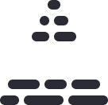

<p align="center">
  <picture>
    <source media="(prefers-color-scheme: dark)" srcset="public/logofullwhite.png" width="360">
    
  </picture>
</p>

# deltaview-www

The website for [Deltaview](https://github.com/DavidAEriksson/deltaview), a Claude Code plugin that opens your app in Chrome with an outline on every element a branch changes, so you can review it where it renders and post one GitHub review.

## Develop

```bash
npm install
npm run dev     # http://localhost:3000
npm run build   # production build
npm run lint
```

Built with Next.js 16, Tailwind CSS 4 and the `@fanzeal-intl/ui` design system.

## Layout

| Path | What it is |
| --- | --- |
| `app/page.tsx` | Landing page, built from the mockup in `redesign/` |
| `app/docs/` | Docs pages, with their own header, nav and footer |
| `app/site.tsx` | Shared constants (`REPO`, `INSTALL`) and the `Command` snippet |
| `app/globals.css` | Design-system tokens, plus the landing page's `dv-*` colours and fonts |
| `public/` | Logos |

The landing page uses its own light palette (Familjen Grotesk and Martian Mono). The docs use the design system's dark theme.
